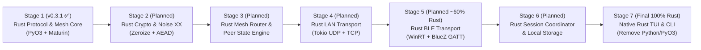

# BitChat Architecture & Rust Migration Roadmap

This document defines the multi-stage engineering roadmap for **BitChat**, tracking its progression from a pure-Python application (`v0.1.0`–`v0.2.1`) through the current hybrid Python + Rust architecture (`v0.3.1`) toward a fully native Rust application.

> **Engineering Policy:** This roadmap describes architectural stages and technical milestones without promising calendar release dates. Only **Stage 1** is implemented in `v0.3.1`; Stages 2 through 7 are planned future engineering phases.

---

## 1. Strategic Architectural Direction

| Milestone Phase | Architectural Ownership | Status |
| :--- | :--- | :--- |
| **Legacy Baseline (`v0.1.0`–`v0.2.1`)** | 100% Python (`asyncio` + `Textual` + pure-Python protocol/mesh) | Superseded |
| **Current Release (`v0.3.1` — Stage 1)** | **Hybrid Python Application + Rust Native Core (`bitchat._bitchat_core`, ~25% Rust hot-path ownership)** | ✅ **Completed & Released (`v0.3.1`)** |
| **Intermediate Milestone (Stages 2–5)** | **~60% Rust Architectural Ownership** (Protocol, Mesh, Crypto, Noise XX, and Transport engines in Rust; Python TUI/CLI shell) | 📋 Planned |
| **Final Objective (Stages 6–7)** | **100% Native Rust Application** (Rust TUI, CLI, Transports, Storage, Crypto, and Protocol; Python, PyO3, and Maturin removed) | 📋 Planned |

---

## 2. Historical Note: Why Rust Replaced the Early Nim Prototype

During early `v0.2.x` exploration, a minimal C-ABI prototype was tested in `nim/` (`nim/protocol/packet_codec.nim`) to evaluate FFI overhead for binary header parsing. Because marshaling trivial structs across `ctypes` offered limited end-to-end gain by itself, profiling under sustained multi-peer mesh workloads demonstrated that moving **stateful, allocation-heavy subsystems** (packet encode/decode, MTU fragmentation, bounded fragment reassembly, SHA-256 deduplication ring caches, and peer rate limiting) into a zero-copy **Rust + PyO3 (`abi3-py312`) + Maturin** crate (`rust/bitchat-core`) eliminated Python object churn and reduced hot-path latency by **6x to 52x**.

The legacy `nim/` directory is retained strictly as an archived historical reference and is not compiled, packaged, or loaded at runtime.

---

## 3. The 7-Stage Python-to-Rust Migration Roadmap

### Stage 1 — Rust Protocol & Mesh Hot-Path Core, TUI Responsiveness & Uninstaller (`v0.3.1` — ✅ Completed)

Implemented in `rust/bitchat-core` (`bitchat._bitchat_core`) and integrated via `src/bitchat/_native.py`:

- **Build & Packaging Foundation:** Cargo workspace (`Cargo.toml`, `rust/bitchat-core/Cargo.toml`) compiled via `maturin` (`pyproject.toml`) into `bitchat._bitchat_core` (`abi3-py312`), bundled into Windows `.exe`, Linux `.deb`, `AppImage`, `Flatpak`, and platform wheels.
- **Native Binary Wire Codec:** `encode_packet_raw`, `decode_packet_raw`, `pad_packet_data`, `unpad_packet_data`, `get_optimal_block_size`, `peer_id_to_hex`, and `peer_id_from_hex` enforcing exact big-endian `BitchatPacket` framing (`FIXED_HEADER_SIZE = 14`, `MINIMUM_PACKET_SIZE = 22`) and PKCS#7-style block padding (`256`/`512`/`1024`/`2048` bytes).
- **Native Fragmentation, Stream Framing & Bounded Reassembly:** `should_fragment_bytes`, `split_chunks`, `create_fragment_payload`, `parse_fragment_payload`, `fragment_encoded_packet_raw`, `NativeFragmentReassembler` (`MAX_FRAGMENTS_PER_ASSEMBLY = 1000`, `MAX_ACTIVE_ASSEMBLIES = 100`, `MAX_REASSEMBLED_BYTES = 150_000`), and `encode_frame_bytes` / `NativeStreamFramer` (`BC\x01\x00` + 4-byte length prefix).
- **Native Mesh Deduplication & Rate Limiting:** `compute_packet_id_raw`, `NativePacketDeduplicator` (SHA-256 `[:16]` digest LRU/TTL cache), and `NativePeerRateLimiter` (bounded sliding-window peer rate limiter).
- **Differential Equivalence & Fallback:** Automatic fallback to pure-Python implementations if `_bitchat_core` is unavailable, verified by differential unit and Hypothesis property tests (`tests/unit/test_native_core.py`).
- **Event-Loop & Textual TUI Optimization:** O(1) incremental message trimming, 16 ms frame-coalesced chat batching, cached autocomplete filtering, non-blocking background thread offloading for storage/subprocess calls, and zero-jitter typing.
- **Cross-Platform Uninstaller:** `bitchat --uninstall` (`--dry-run`, `--remove-user-data`, `--yes`) cleaning standalone binaries, multi-Python console scripts (`Python3XX\Scripts\bitchat.exe`), shortcuts, registry entries, and BitChat-owned `PATH` entries.

---

### Stage 2 — Rust Cryptography & Noise XX Session Engine (📋 Planned)

- Migrate `X25519`, `Ed25519`, `ChaCha20-Poly1305`, `AES-256-GCM`, `HKDF-SHA256`, and `PBKDF2-HMAC-SHA256` to audited Rust crates (`x25519-dalek`, `ed25519-dalek`, `chacha20poly1305`, `aes-gcm`, `hkdf`, `pbkdf2`, `sha2`).
- Implement the full `Noise_XX_25519_ChaChaPoly_SHA256` handshake and transport `CipherState` machine in `rust/bitchat-core`.
- Enforce deterministic memory scrubbing (`zeroize::ZeroizeOnDrop`) for static private keys, ephemeral handshake keys, and symmetric session keys so secret material never resides in unzeroized Python `bytes` objects.
- Maintain 100% wire compatibility and differential test parity against `src/bitchat/crypto/`.

---

### Stage 3 — Rust Mesh Routing Table & Multi-Hop Scheduler (📋 Planned)

- Migrate `MeshRouter` (`src/bitchat/mesh/router.py`), peer table management, hop-count decrementing, broadcast flood control, and retry scheduling into `rust/bitchat-core`.
- Unify packet decoding, deduplication, reassembly, Noise decryption, and forwarding decisions inside a single Rust pipeline call to eliminate repeated Python/Rust boundary crossings per packet.

---

### Stage 4 — Native Rust LAN Transport Engine (📋 Planned)

- Migrate `LANDiscovery` (UDP broadcast beacons on port `41234`, per-IP rate limiting), `LANServer` / `LANConnection` (4-byte length-prefixed TCP streams on port `41235`), and network interface snapshot detection into an asynchronous Rust (`tokio`) transport engine inside `rust/bitchat-core`.

---

### Stage 5 — Native Rust BLE Transport Engine (~60% Rust Milestone — 📋 Planned)

- Migrate BLE Central scanning, GATT client connections, and BLE Peripheral GATT server advertising (`F47B5E2D-4A9E-4C5A-9B3F-8E1D2C3A4B5C` / `A1B2C3D4-E5F6-4A5B-8C9D-0E1F2A3B4C5D`) from Python (`bleak` / `winrt` / `dbus-fast`) to native Rust platform backends (Windows WinRT and Linux BlueZ D-Bus).
- Reaching Stage 5 completes the **~60% Rust intermediate architectural milestone**, where all networking, BLE radio management, cryptography, and mesh routing execute natively in Rust while Python hosts only the high-level application configuration and Textual UI.

---

### Stage 6 — Rust Session Coordinator, Local Storage & Uninstaller (📋 Planned)

- Migrate `SessionCoordinator` (`src/bitchat/app/session_coordinator.py`), `FileConfigStorage` (`config.json`, `identity.json`, cross-process file locking, Windows DACL / POSIX `0600` enforcement), rotating redacted logging, and the cross-platform uninstaller into Rust crates.
- Introduce optional passphrase-protected key encryption at rest for `identity.json`.

---

### Stage 7 — Native Rust Terminal UI & Removal of Python/PyO3/Maturin (📋 Planned — Final Objective)

- Replace the Python Textual TUI (`src/bitchat/tui/`) and CLI (`src/bitchat/__main__.py`) with a native Rust terminal UI (`ratatui` + `crossterm`) preserving the `HomeScreen`, Peer Grid, Chat Screen, Settings Screen, Connection Modal, and slash commands.
- Remove `pyproject.toml`, `uv.lock`, `PyO3`, `Maturin`, and `PyInstaller`, shipping BitChat as a single, small, zero-dependency native Rust binary across Windows, Linux, and macOS.
