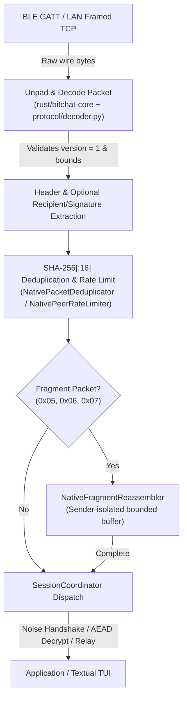

# BitChat Protocol Overview (`v0.3.1`)

This document provides a technical overview of the BitChat binary wire protocol (Version 1), defining its packet flow, constants, and the actual hybrid Rust (`rust/bitchat-core`) + Python (`src/bitchat/`) implementation structure in `v0.3.1`.

## Key Protocol Constants

- **Protocol Version**: `1` (wire byte `0x01`)
- **Default TTL**: `3` in `AppConfig` (`max_hops` configurable `1`–`7`; wire max `7`)
- **BLE Service UUID**: `F47B5E2D-4A9E-4C5A-9B3F-8E1D2C3A4B5C`
- **BLE Characteristic UUID**: `A1B2C3D4-E5F6-4A5B-8C9D-0E1F2A3B4C5D`
- **LAN Default Ports**: UDP Discovery `41234`, Framed TCP Stream `41235` (`BC\x01\x00` + 4-byte length)
- **Broadcast Recipient ID**: `b"\xff\xff\xff\xff\xff\xff\xff\xff"` (`ffffffffffffffff`)
- **Fixed Header Size**: `14` bytes (`FIXED_HEADER_SIZE`) before `sender_id`; `22` bytes minimum packet size (`MINIMUM_PACKET_SIZE`)
- **Signature Size**: `64` bytes (Ed25519)
- **Fragmentation**: `500`-byte threshold (`FRAGMENTATION_THRESHOLD`), `150`-byte chunk payload (`FRAGMENT_CHUNK_SIZE`), `13`-byte fragment header (`FRAGMENT_HEADER_SIZE`)
- **Block Sizes (Padding)**: `256`, `512`, `1024`, `2048` bytes (PKCS#7-style trailing pad count)

## Protocol Flow

The flow for processing inbound BitChat packets over BLE or LAN is as follows:

### Packet Processing Pipeline

1. **Packet Unpadding & Decoding (`rust/bitchat-core/src/protocol.rs` & `src/bitchat/protocol/decoder.py`)**:
   - Strips validated PKCS#7-style block padding (`unpad_packet_data`).
   - Validates the version byte (`1`) and 14-byte fixed header (`version`, `message_type`, `ttl`, `timestamp`, `flags`, `payload_len`) plus 8-byte `sender_id`.
   - Conditionally reads the 8-byte `recipient_id` (`FLAG_HAS_RECIPIENT = 0x01`), `payload_len` bytes of `payload`, and 64-byte `signature` (`FLAG_HAS_SIGNATURE = 0x02`).

2. **Fragment Reassembly (`rust/bitchat-core/src/fragmentation.rs` & `src/bitchat/protocol/reassembly.py`)**:
   - Reassembles multi-part packets (`FragmentStart`, `FragmentContinue`, `FragmentEnd`) keyed by `(sender_id, fragment_id)` with strict bounds (`MAX_FRAGMENTS_PER_ASSEMBLY = 1000`, `MAX_ACTIVE_ASSEMBLIES = 100`, `MAX_REASSEMBLED_BYTES = 150_000`).

3. **Mesh Deduplication, Rate Limiting & Relay (`rust/bitchat-core/src/mesh.rs` & `src/bitchat/mesh/`)**:
   - Computes TTL-invariant 16-byte SHA-256 packet digests (`compute_packet_id_raw`) and drops duplicates via `NativePacketDeduplicator` (1,000-entry LRU with 300s TTL).
   - Enforces per-peer rate limits (`NativePeerRateLimiter`, 50 packets/sec).
   - Relays eligible broadcast or non-local unicast packets when `TTL > 1` with 10–50 ms collision jitter, or queues packets in `StoreAndForwardQueue` for disconnected peers.

4. **Session Coordination & Cryptography (`src/bitchat/app/session_coordinator.py` & `src/bitchat/crypto/`)**:
   - Processes `Noise_XX_25519_ChaChaPoly_SHA256` handshake messages (`0x10`, `0x11`), verifies post-handshake `peer_id == SHA-256(x25519_pub)[:8]` binding and TOFU contact fingerprints, and decrypts `NoiseEncrypted` (`0x12`) transport frames.

## Actual Module Architecture Mapping (`v0.3.1`)

| Subsystem | Rust Core (`rust/bitchat-core/src/`) | Python Module (`src/bitchat/`) | Responsibility |
|---|---|---|---|
| **Constants & Wire Types** | `protocol.rs` | `protocol/constants.py`, `protocol/packet.py` | `MessageType` enum (`0x01`–`0x25`), BLE UUIDs, header flags, `BitchatPacket` model |
| **Binary Codec & Padding** | `protocol.rs` | `protocol/encoder.py`, `protocol/decoder.py` | Big-endian packet serialization, deserialization, and block padding (`256`–`2048` B) |
| **Fragmentation & Reassembly** | `fragmentation.rs` (`NativeFragmentReassembler`) | `protocol/fragmentation.py`, `protocol/reassembly.py` | Splitting packets `> 500` B into `150` B chunks with 13 B headers and bounded reassembly |
| **TCP Stream Framing** | `framing.rs` (`NativeStreamFramer`) | `network/framing.py` | 8-byte `BC\x01\x00` + length-prefixed stream framing for LAN TCP connections |
| **Mesh Routing & Dedup** | `mesh.rs` (`NativePacketDeduplicator`, `NativePeerRateLimiter`) | `mesh/dedup.py`, `mesh/router.py`, `mesh/store_forward.py` | SHA-256 `[:16]` deduplication, peer rate limiting, TTL relay, and Store-and-Forward |
| **Noise XX & Crypto** | *(Planned Stage 2)* | `crypto/noise.py`, `sessions.py`, `identity.py`, `aes_gcm.py`, `ed25519.py`, `x25519.py`, `hkdf.py`, `pbkdf2.py` | `Noise_XX_25519_ChaChaPoly_SHA256`, `AES-256-GCM`, `Ed25519`, `X25519`, `LocalIdentity` |
| **Session Coordinator** | *(Planned Stage 6)* | `app/session_coordinator.py`, `app/application.py` | Handshake orchestration, transport switching, delivery ACKs, read receipts |
| **BLE & LAN Transports** | *(Planned Stages 4–5)* | `ble/`, `network/`, `transport/` | Bleak / WinRT / BlueZ D-Bus GATT Central & Peripheral; LAN UDP (`41234`) & TCP (`41235`) |
| **Local Storage & Logging** | *(Planned Stage 6)* | `storage/config.py`, `logging/__init__.py` | `~/.bitchat/config.json`, `~/.bitchat/identity.json` (`0600` / Windows DACL), redacted `bitchat.log` |
| **TUI & CLI** | *(Planned Stage 7)* | `tui/`, `commands/parser.py`, `__main__.py` | Textual terminal UI (`HomeScreen`, `ChatScreen`, `SettingsScreen`) and CLI commands |
